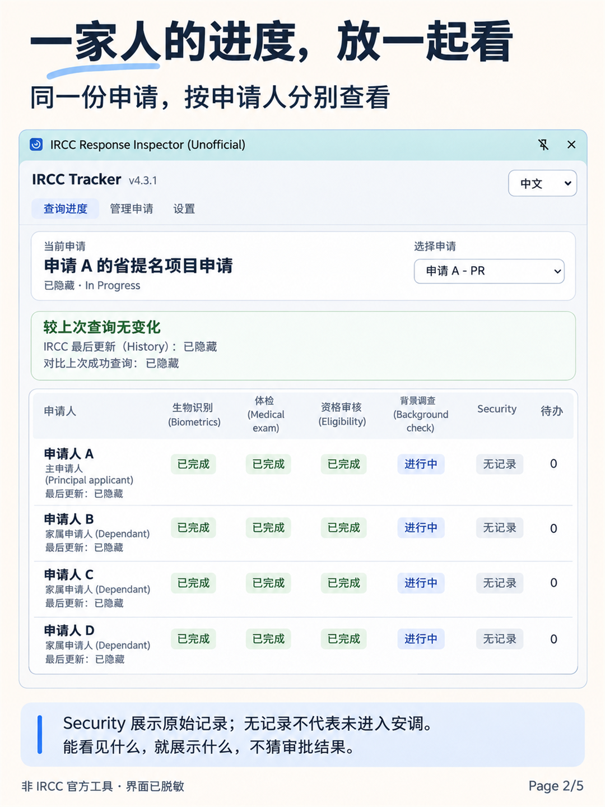
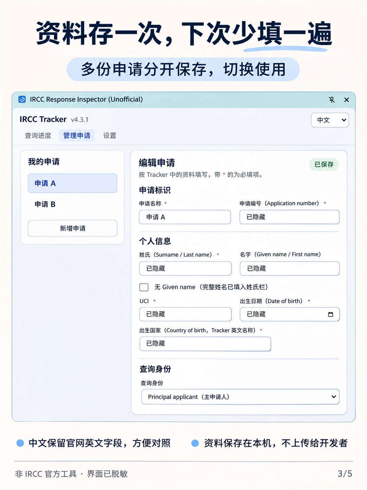
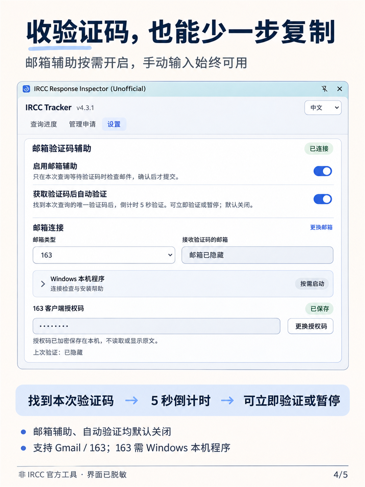
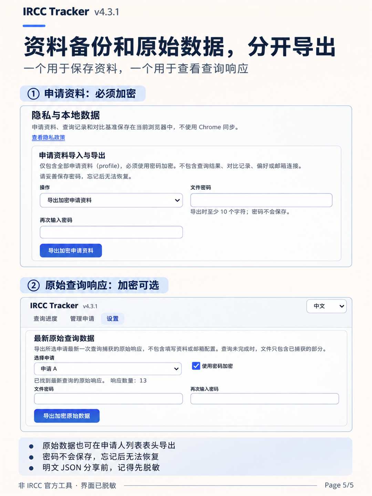

# IRCC Response Inspector

> 4.3.3：原始数据导出保留采集内容，支持可选加密，并明确显示采集缺失与完整性状态。参见[安装与授权说明](MAIL-SETUP.md)。

[简体中文](README.md) · [English](README.en.md)

**非官方 Chrome 扩展 · 本机处理 · MIT 开源**

将 IRCC Tracker 的申请进度、分申请人 History、Security 原始状态和上次查询对比整理到一个界面。无需自己打开开发者工具抓包或翻找 JSON；用户自行登录；手动输入验证码始终可用，也可按需开启邮箱辅助及独立的自动验证。

本工具与 IRCC、加拿大政府无隶属或背书关系，不预测审批结果，也不猜译未公开状态代码。

## 主要功能

- “常用链接”页集中提供 PR Portal、IRCC Portal、新版 Portal、GCKey、IRCC / CBSA / CSIS ATIP、官方状态入口、处理时间和 Web form；外部网站在新标签页打开。

- 多份申请资料分别保存，选择 profile 后辅助填写官方表单。
- 分申请人查看生物识别、体检、资格审核、背景调查、待办与本次获取的 History 记录。
- 原样展示 Security 状态代码，保留历史条目。
- 与同一 profile 上次完整成功查询对比，标记变化和新增 History；失败查询不会覆盖基准。
- 默认中文，可切换英文；中文保留 Surname / Last name、Given name 等原网站字段名。
- 申请资料支持强制密码加密的导入与导出；最新原始响应可单独导出为 JSON 或密码加密文件。邮箱凭据和验证码不导出。

## 功能预览

以下为 4.3.1 界面的脱敏展示图，姓名、编号、生日、邮箱和具体时间均已隐藏。图片经过生成式编辑及版式重排，仅用于说明功能，不作为原始查询结果凭证。Security 的“无记录”不能据此认定未进入安调。旧图中的“最后更新”仅指 History 最新记录时间，不代表 IRCC 内部最后处理时间。

<table>
<tr>
<td width="50%"><strong>申请人进度与 History</strong> </td>
<td width="50%"><strong>多份申请资料管理</strong> </td>
</tr>
<tr>
<td width="50%"><strong>可选邮箱辅助与倒计时验证</strong> </td>
<td width="50%"><strong>资料与原始响应分别导出</strong> </td>
</tr>
</table>

## 安装

1. 前往 [Releases](https://github.com/Will4096/ircc-response-inspector/releases)，下载带版本号的安装 ZIP；不要选自动生成的 Source code 压缩包。
2. 解压安装包，打开 Chrome 的 **chrome://extensions** 页面。
3. 开启“开发者模式”，点击“加载已解压的扩展程序”。
4. 选择包含 **manifest.json** 的解压目录，可将扩展固定到工具栏。

这是 GitHub 分发的解压安装版，不代表已通过 Chrome 应用商店审核。已有安装更新文件后需重新加载扩展，并刷新 Tracker。[downloads](downloads) 目录保留安装包镜像。

## 使用

1. 打开 Tracker，自行完成登录。
2. 通过“管理申请”保存资料，确认当前申请，再辅助填写。
3. 核对已填写的资料；5 秒倒计时可立即提交或取消。手动输入验证码，或在设置中连接邮箱后使用辅助取码；自动验证需单独开启。
4. 查看进度，展开各申请人的 History，需要时创建加密备份。

语言可在主面板顶部或扩展选项的“设置”中切换。偏好保存在本机，已打开的扩展页面会同步更新。

## 隐私与权限

没有开发者服务器、广告、遥测或外部 AI。申请资料、偏好和比较基准保存在本机 Chrome 存储，查询缓存使用会话存储，不使用 Chrome Sync。查询所需信息仍通过 IRCC 官方页面提交。

调试权限用于可靠填写表单及读取所选 Tracker 标签页的响应。Chrome 可能显示调试提示；查询结束、失败、超时或离开 Tracker 后断开。查询时请勿同时打开该标签页的 DevTools。

资料、History 和导出仍可能包含个人敏感信息，本地保存不等于加密。删除申请可清理其缓存及基准；“清除浏览器内数据”清理扩展存储，并在可用时清理 helper 凭据；本机程序、诊断日志及导出文件需另行删除。

[隐私政策](PRIVACY.md) · [安全说明](SECURITY.md) · [发布说明](PUBLISHING.md)

## 开发与验证

当前版本：4.3.3。无第三方运行时依赖。使用 Node.js 22 或更高版本：

~~~sh
node tests.mjs
node comparison-tests.mjs
node i18n-tests.mjs
node privacy-tests.mjs
node scripts/build-release.mjs
~~~

构建使用运行文件白名单，生成安装 ZIP 及 SHA-256 校验文件。自动测试使用合成数据，不包含真实账号或验证码。官方页面可能变化，真实登录流程仍需用户实测。

## 问题反馈

请在 [Issues](https://github.com/Will4096/ircc-response-inspector/issues) 中提供扩展版本、浏览器版本及复现步骤。不要公开姓名、UCI、申请编号、出生日期、验证码、cookie、token、真实截图或未脱敏的导出。

## 许可证

采用 [MIT 许可证](LICENSE)，版权所有者为 Will4096。可按许可条款使用、修改和分发，须保留版权和许可声明。

## 使用边界

展示可能延迟、遗漏或解析有误。申请状态、补件要求、截止期限和审批结果，请以 IRCC 官方账户及正式通知为准。History 最新记录时间不代表内部最后处理时间；Security 原始值不能确定安调结论。本工具不提供移民/法律建议或加速审批，不限制依法不得排除的权利。Gmail 生产资格与服务条款需另行核实，见[发布门槛](PUBLISHING.md)。敏感反馈优先使用可用的私密安全入口，不在公开 Issue 提交详情。
